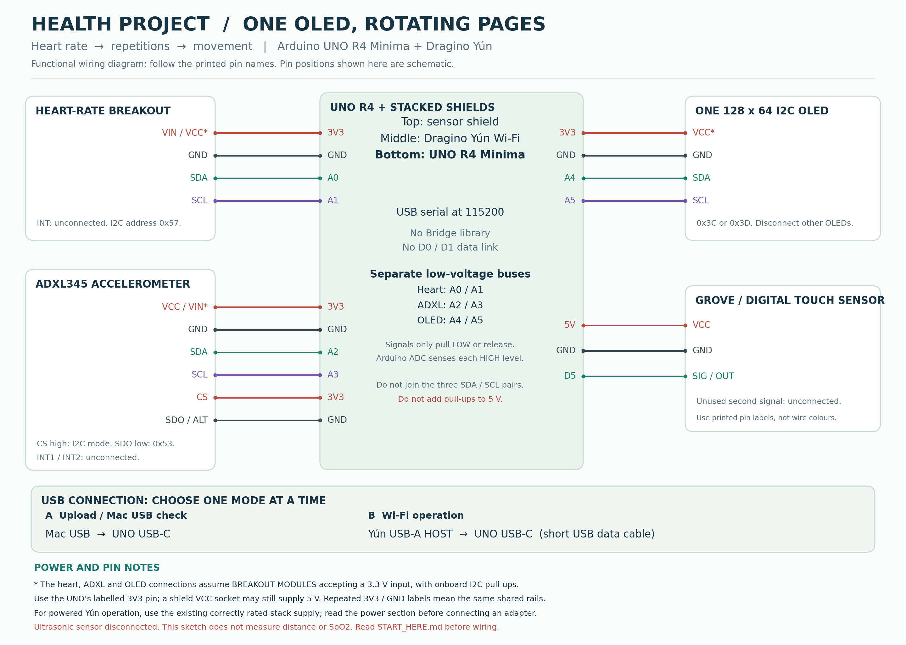

# Arduino Health / Exercise Project

一个基于 Arduino UNO R4 Minima 的健康与运动监测原型。项目使用光学心率
传感器、加速度计、触摸传感器和 OLED，显示估算心率、动作次数与动作姿态
一致性，并可通过 Windows、macOS 或 Dragino Yun 查看实时数据。

> 这是工程课程与原型演示项目。心率属于估算值，不用于医疗诊断；项目不提供
> 血氧、疲劳或临床动作评估。

## 功能

- 估算心率并显示脉搏采集状态
- 使用加速度计检测前臂姿态变化
- 通过“起始姿势 → 目标姿势 → 起始姿势”统计重复次数
- 比较后续动作与首次有效动作的持续时间和变化程度
- 一块 128×64 OLED 自动轮换显示三页数据
- Windows/macOS 本地实时网页
- Yun 本地 Wi-Fi 网页
- 支持 ADXL345、BMA150 和 BMX160 加速度计

## 硬件

- Arduino UNO R4 Minima
- Dragino Yun 扩展板（可选）
- MAX30100 或 MAX30102/05 心率传感器
- ADXL345、BMA150 或 BMX160 加速度计
- 数字/触摸传感器
- 128×64 SSD1306/SSD1315 I2C OLED
- 独立 7–12 V 稳压电源（按实际扩展板要求确认）

详细接线见 [START_HERE.md](START_HERE.md) 和 `wiring.pdf`。

## OLED 三页

| 页面 | 主要内容 |
|---|---|
| 心率 `1/3` | 估算 BPM、脉搏状态、原始 IR、运动干扰提示 |
| 次数 `2/3` | 次数/目标、会话状态、校准提示、姿势角差、持续时间 |
| 动作 `3/3` | 相对起始姿势的角度、动作一致性、上次动作和参考时长 |

页面每 4 秒自动切换。校准期间会停留在次数页。

## Windows 快速开始

1. 在 Arduino IDE 中安装 **Arduino UNO R4 Boards**。
2. 安装 **SparkFun MAX3010x Pulse and Proximity Sensor Library**。
3. 打开 `R4_Health/R4_Health.ino` 并上传到 Arduino UNO R4 Minima。
4. 关闭 Arduino IDE 的 Serial Monitor。
5. 双击 `windows/Run_Health_Checker.bat`。
6. 浏览器打开 `http://127.0.0.1:8770/`。

手机与电脑在同一网络时，可双击 `windows/Run_Phone_Viewer.bat`，再用命令
窗口显示的局域网地址访问。

## 使用流程

1. 轻点触摸传感器进入设置。
2. 保持起始姿势约 1 秒，再轻点保存。
3. 移动到目标姿势，保持稳定约 1 秒，再轻点保存。
4. 两个姿势的倾斜变化至少需要 25°。
5. 再轻点一次开始运动。
6. 每个完整“起始 → 目标 → 起始”循环并停顿后计为一次。

## 项目文档

- [START_HERE.md](START_HERE.md)：完整接线、上传、Yun 安装和操作说明
- [WINDOWS_AND_GIT.md](WINDOWS_AND_GIT.md)：Windows、手机访问和 Git 使用
- [GITHUB_GROUP.md](GITHUB_GROUP.md)：小组协作与 Pull Request 流程
- [VALIDATION.md](VALIDATION.md)：软件测试记录与仍需完成的硬件检查

## 测试状态

- Arduino UNO R4 Minima 编译通过
- Windows 串口与网页实时数据通过
- BMX160 在地址 `0x68`、芯片 ID `0xD8` 下完成实物验证
- 后续版本仍在开发中，硬件接线与供电请以项目文档为准
